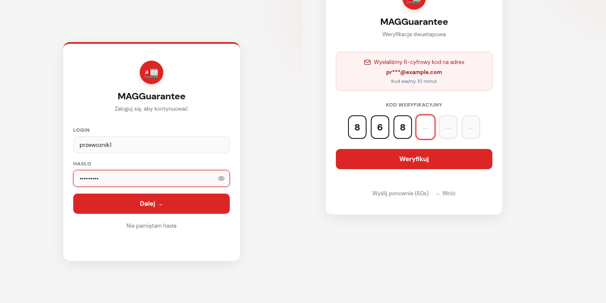
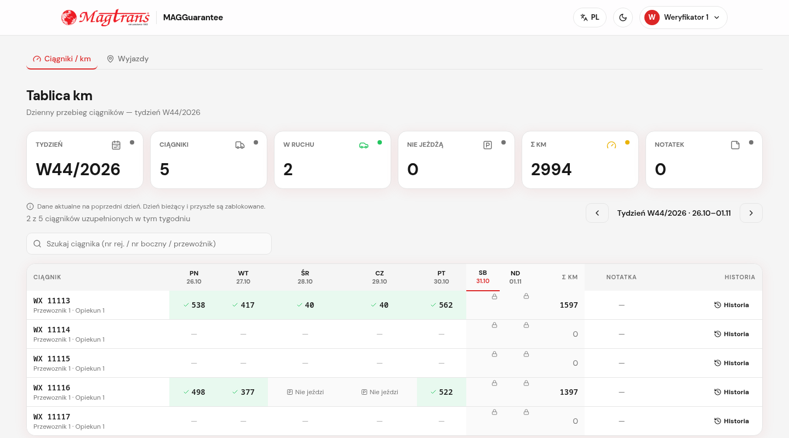
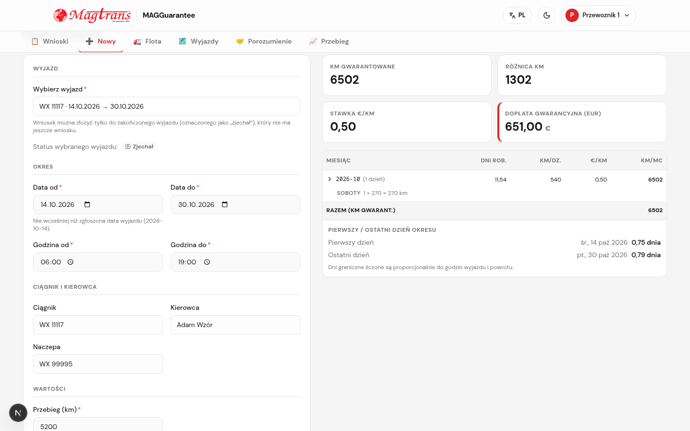
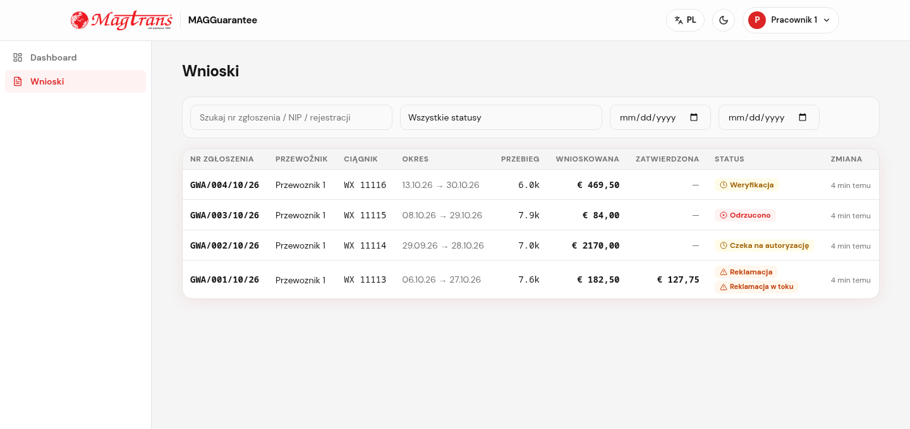
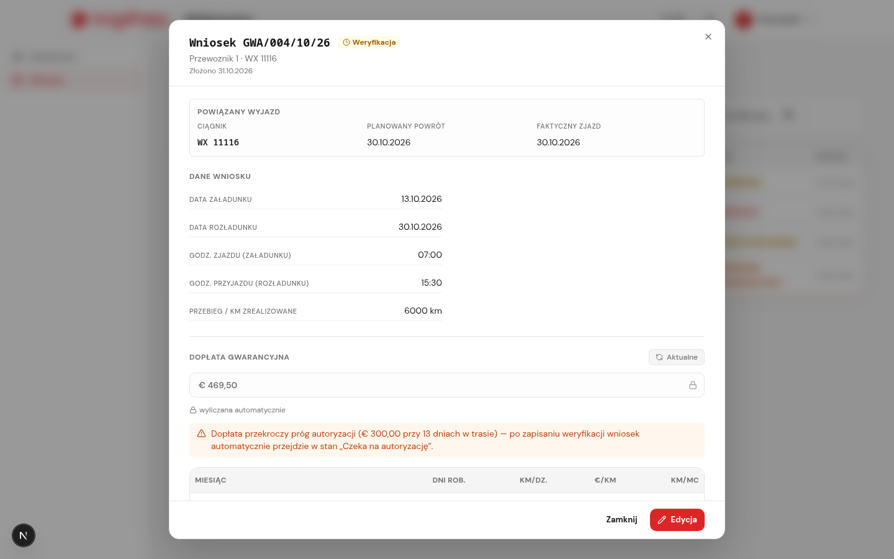
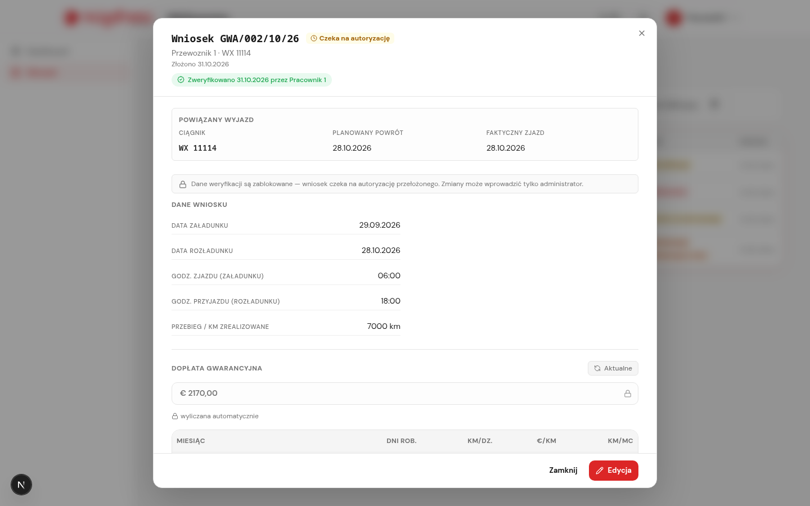
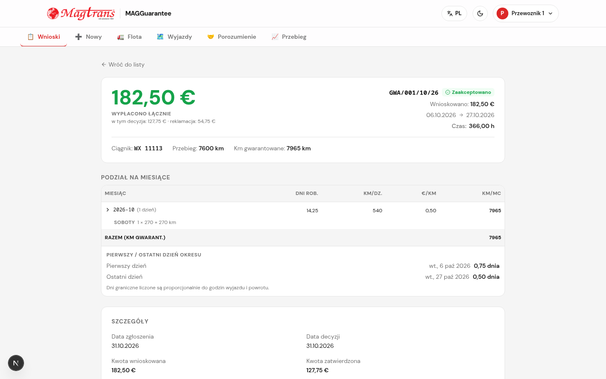
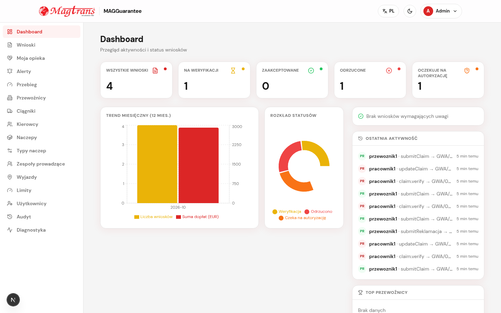
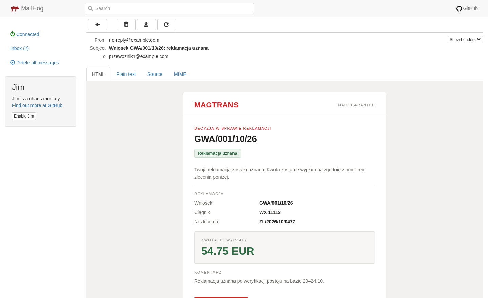

# 1. Podstawowe informacje

%%CELL Nazwa projektu%%

MAGGuarantee: system zarządzania wnioskami o gwarancję kilometrową dla firmy
transportowej (wewnętrzna aplikacja webowa dla firmy logistycznej MAGTRANS).

%%CELL Cel projektu%%

Gwarancja kilometrowa jest zobowiązaniem umownym wobec przewoźników
(podwykonawców): jeżeli pojazd w danym okresie przejechał mniej kilometrów,
niż gwarantuje umowa (limit km na dzień roboczy), przewoźnik otrzymuje
rekompensatę w EUR za różnicę. Proces ten nie miał dotąd wsparcia
systemowego. Istniał jedynie nieukończony prototyp w Google Apps Script
i Google Sheets, nigdy niewdrożony i bez danych produkcyjnych, który
posłużył wyłącznie jako referencja funkcjonalna.

Celem projektu jest zbudowanie od podstaw kompletnej aplikacji, która:

- prowadzi przewoźnika od zgłoszenia wyjazdu, przez złożenie wniosku,
  po decyzję i ewentualną reklamację,
- oblicza należną kwotę jednym, testowanym silnikiem, współdzielonym
  przez backend i frontend,
- rozdziela uprawnienia ośmiu ról (admin, pracownik, opiekun, planista,
  dyspozytor, przewoźnik, eksport, weryfikator),
- zapisuje każdą operację zmieniającą dane w dzienniku audytu, atomowo
  z samą zmianą,
- chroni dostęp logowaniem dwuskładnikowym (hasło + kod e-mail)
  i tokenami JWT,
- działa w kontenerach na jednym serwerze VPS z automatycznym wdrożeniem
  z GitHub Actions.

Problem rozwiązywany jest po stronie działu rozliczeń MAGTRANS (czas
i błędy ręcznego liczenia, brak śladu rewizyjnego) oraz po stronie
przewoźników (przejrzystość naliczeń, jeden kanał składania wniosków
i reklamacji).

%%CELL Krótki opis projektu%%

System obsługuje dwa powiązane procesy: **delegację** (wyjazd pojazdu)
i **wniosek** o gwarancję.

1. Przewoźnik rejestruje wyjazd (pojazd, kierowca, naczepa, planowany
   termin). Weryfikator potwierdza faktyczny moment wyjazdu i powrotu
   oraz prowadzi dzienną tablicę przebiegów pojazdów.
2. Po powrocie przewoźnik składa wniosek: wskazuje wyjazd, okres, godziny
   i przebieg. System liczy dni robocze (bez niedziel, świąt i zakazów
   ruchu w UE, z Wielkanocą, z dniami ułamkowymi na brzegach okresu
   i zaliczanymi sobotami), mnoży je przez miesięczny limit km/dzień
   i ważoną stawkę EUR/km, po czym wyznacza dopłatę.
3. Pracownik weryfikuje wniosek z podglądem przeliczenia na żywo
   i zapisuje weryfikację. Jeżeli kwota przekracza próg zależny od długości
   trasy, wniosek automatycznie czeka na autoryzację osoby decyzyjnej
   (e-mail oraz zrzut ekranu potwierdzenia).
4. Decyzja (akceptacja lub odrzucenie) trafia e-mailem do przewoźnika
   i zespołu. Przewoźnik może w ciągu 48 godzin złożyć jedną reklamację
   dotyczącą wyłącznie kwoty.

Wokół tego rdzenia działają: kartoteki floty (przewoźnicy, pojazdy,
naczepy, kierowcy, załączniki w magazynie S3), miesięczne limity i stawki,
panel KPI, raport tygodniowy, cykliczne alerty (SLA weryfikacji, watchdog
gwarancji) oraz interfejs w języku polskim i angielskim.

Stan projektu na dzień zamrożenia (tag `praca-dyplomowa`, 17.08.2026):
662 pliki TypeScript (ok. 123 tys. linii, w tym ok. 31 tys. w testach),
102 pliki testów, 22 modele i 20 typów wyliczeniowych Prisma, 53 migracje
bazy danych, 26 kontrolerów i 133 endpointy REST, 48 stron Next.js,
20 szablonów e-mail, 215 commitów (28.04–17.08.2026).

%%CELL Analiza konkurencji%%

Nie istnieje gotowy produkt, który modeluje gwarancję kilometrową jako
proces. Porównanie dotyczy więc klas rozwiązań, którymi firma mogłaby
zastąpić system dedykowany.

**Arkusz kalkulacyjny + Google Apps Script** (zastany prototyp).
Zalety: brak kosztów licencji, szybki start, znane środowisko.
Wady: brak kontroli dostępu per rola, brak transakcji i audytu, logika
w jednym pliku o ok. 7,5 tys. linii, hasła jawnym tekstem, limity czasu
wykonania GAS, brak testów.

**Systemy TMS** (fireTMS, interLAN SPEED, Trans.eu).
Zalety: dojrzałe moduły zleceń, floty i fakturowania, wsparcie producenta.
Wady: brak modułu gwarancji kilometrowej, licencja na każdego użytkownika
(także przewoźników zewnętrznych), ograniczona personalizacja workflow
i formuł, dane poza firmą.

**Telematyka** (Webfleet, Samsara).
Zalety: automatyczne przebiegi z GPS, pozycje pojazdów.
Wady: tylko źródło danych, brak wniosku, ról, decyzji i reklamacji;
abonament na każdy pojazd.

**Platformy low-code** (Airtable, Microsoft Power Apps).
Zalety: szybkie formularze i tablice, wbudowane workflow.
Wady: złożona formuła (dni ułamkowe, święta UE, ważona stawka) trudna
do utrzymania i testowania, licencje per użytkownik, uzależnienie
od dostawcy, słabe RBAC dla użytkowników zewnętrznych.

**MAGGuarantee** (niniejszy projekt).
Zalety: pełny proces gwarancji w jednym systemie, formuła w jednym miejscu
i pokryta testami, 8 ról z audytem każdej zmiany, brak licencji
per użytkownik, dane na własnym serwerze, gotowe miejsce na integrację
z TMS i GPS. Wady: koszt własnego rozwoju i utrzymania, zależność
od jednego zespołu, brak modułów TMS (zlecenia, fakturowanie), które nadal
żyją w innych systemach.

Wniosek: tylko system dedykowany pokrywa pełny proces gwarancji bez
licencji per użytkownik i z pełną kontrolą nad formułą oraz danymi; koszt
własnego rozwoju jest akceptowalny, bo proces jest stabilny i specyficzny
dla firmy. TMS i telematyka pozostają źródłami danych, nie konkurencją.
Architektura MAGGuarantee przewiduje taką integrację (pole `source = gps`
w dziennych przebiegach pojazdu).

%%CELL Wykaz zastosowanych technologii%%

Wersje według `package.json` i obrazów Docker na dzień zamrożenia:

- Node.js 20 LTS (obraz `node:20-alpine`), TypeScript 5.9
- NestJS 10.4 (backend)
- Prisma 5.22 (ORM), PostgreSQL 16 (baza danych)
- Redis 7 (cache, kody 2FA), BullMQ 5.78 (kolejki i zadania cykliczne)
- Next.js 15.5 (App Router), React 19.2 (frontend)
- Tailwind CSS 4.2, shadcn/ui (Radix) (style i komponenty)
- TanStack Query 5, React Hook Form 7, Zod 3.25 (stan, formularze,
  walidacja)
- next-intl 3 (PL/EN)
- Passport JWT 4, @nestjs/jwt 11, bcrypt (uwierzytelnianie)
- Nodemailer 8, React Email 1, Gmail API (e-mail)
- AWS SDK v3 / S3 (MinIO w środowisku dev) (pliki)
- Jest 29 (api), Vitest 2 (shared, web) (testy)
- Docker, Docker Compose, Caddy 2, GitHub Actions, GitHub Container Registry
  (infrastruktura)

%%CELL Opis stosu technologicznego i uzasadnienie wybranych technologii%%

**Powiązania.** Przeglądarka uruchamia aplikację Next.js (`apps/web`),
która przez HTTPS wywołuje REST API NestJS (`apps/api`). Oba programy
importują pakiet `packages/shared` ze schematami Zod i logiką domenową,
a API dodatkowo pakiet `packages/database` z klientem Prisma. API korzysta
z PostgreSQL (dane i transakcje), Redis (kody 2FA, blokady, kolejki BullMQ),
magazynu S3 (załączniki) oraz Gmail API lub SMTP (poczta). Całość działa
w jednym stosie Docker Compose za odwrotnym proxy Caddy; obrazy buduje
i publikuje GitHub Actions. Schemat warstw przedstawia rys. 1 w rozdziale 2.

**Uzasadnienie.** *TypeScript na całej długości*: backend, frontend
i pakiety współdzielone są pisane w jednym języku, więc schematy Zod
i logika domenowa są importowane po obu stronach. Typy DTO wyprowadza
`z.infer`, bez osobnej specyfikacji OpenAPI; API i formularze nie mogą
się rozjechać, bo nie przeszłoby to kompilacji. W aplikacji web pakiet
współdzielony importuje 148 plików, a 18 formularzy używa tych samych
schematów przez `zodResolver`.

*NestJS* zamiast gołego Express lub Fastify: wymagania przekrojowe
projektu (role, własność danych przewoźnika, audyt, walidacja) mapują się
wprost na dekoratory, guardy, interceptory i pipe'y. Kontroler deklaruje
`@Roles(...)` i `@Audit(...)`, a reguły działają jednolicie dla 133
endpointów.

*Prisma + PostgreSQL*: Prisma daje typowany klient i migracje
w repozytorium (53 migracje). PostgreSQL daje transakcje interaktywne,
typ `Decimal` dla kwot (pieniądze nigdy nie są liczbą
zmiennoprzecinkową), `JSONB` dla rozbicia obliczeń i wpisów audytu oraz
ograniczenia w bazie (jeden wniosek na wyjazd, jedna stawka na miesiąc).
Model danych jest silnie relacyjny, więc baza relacyjna była naturalnym
wyborem.

*Redis + BullMQ*: Redis przechowuje kody 2FA z czasem życia, liczniki prób
i blokady. BullMQ obsługuje kolejkę e-mail z ponawianiem oraz zadania
cykliczne (digest SLA weryfikacji, raport tygodniowy, watchdog gwarancji,
alert o usunięciu pojazdu).

*Next.js 15 + Tailwind + shadcn/ui*: grupy tras App Routera dają osobny
layout dla każdej roli. Tailwind i komponenty shadcn (kod we własnym
repozytorium, bez zależności od dostawcy) pozwalają odwzorować istniejący
projekt graficzny. TanStack Query buforuje dane serwera, React Hook Form
z Zod obsługuje formularze, next-intl zapewnia PL/EN na podstawie cookie.

*Docker + Caddy + GitHub Actions*: całość (api, web, PostgreSQL, Redis,
MinIO) działa w jednym stosie Compose na pojedynczym VPS, a Caddy zapewnia
automatyczne HTTPS. Obrazy budują się wieloetapowo (`deps`, `build`, `prod`)
i trafiają do GitHub Container Registry; pipeline CI uruchamia lint,
typecheck, testy i build. Przy 15–20 równoczesnych użytkownikach
pojedynczy serwer jest świadomym kompromisem kosztowym.

*Świadomie odrzucone*: Turborepo i pnpm (prostszy build w Dockerze z npm
workspaces), Vercel (dane firmowe pozostają na własnym serwerze), Swagger
(kontrakt żyje w Zod), zewnętrzny monitoring błędów (wystarczają logi Pino
w `docker logs`).

%%ENDTABLE%%

# 2. Kluczowe zagadnienia związane z realizacją projektu

## 2.1. Architektura monorepo i przepływ żądania

Aplikacja jest monorepo npm workspaces z czterema pakietami; kontrakt API żyje w pakiecie współdzielonym, a nie w zewnętrznej specyfikacji.

```
magguarantee-app/
├── apps/api            NestJS: 29 modułów, 26 kontrolerów, 133 endpointy REST
├── apps/web            Next.js: 48 stron w grupach tras (public, carrier, employee,
│                       weryfikator, planista, dyspozytor, eksport)
├── packages/shared     schematy Zod (DTO), logika domenowa: km-calc, kalendarz UE,
│                       reguły wniosku i reklamacji
└── packages/database   Prisma: schema (22 modele), 53 migracje, seed
```

{width=16cm}

Schematy i logika domenowa z pakietu `shared` są importowane po obu stronach; żądanie z przeglądarki przechodzi przez guardy, walidację Zod i interceptor audytu, zanim dotknie bazy.

**Kontrakt najpierw.** Każdy endpoint waliduje ciało żądania tym samym schematem Zod, którego używa formularz w przeglądarce. Typ DTO jest wyprowadzany ze schematu, więc nie ma osobnej klasy DTO do utrzymania.

```ts
// packages/shared/src/schemas/claims.ts (fragment)
export const SubmitClaimSchema = z.object({
  delegationId: UuidSchema,   // wyjazd w statusie zjechal, bez wniosku
  dateStart: IsoDateSchema,   // nie wcześniej niż zgłoszony wyjazd
  dateEnd: IsoDateSchema,
  timeFrom: HhMmSchema,
  timeTo: HhMmSchema,
  mileage: MileageSchema,     // > 0, limit średniodobowy
  comment: z.string().max(2_000).optional(),
});
export type SubmitClaimDto = z.infer<typeof SubmitClaimSchema>;
```

```ts
// apps/api/src/common/pipes/zod-validation.pipe.ts
@Injectable()
export class ZodValidationPipe<T> implements PipeTransform<unknown, T> {
  constructor(private readonly schema: ZodSchema<T>) {}

  transform(value: unknown): T {
    const parsed = this.schema.safeParse(value);
    if (!parsed.success) {
      throw new BadRequestException({
        statusCode: 400,
        message: 'Validation failed',
        issues: parsed.error.issues.map((i) => ({
          path: i.path.join('.'), message: i.message, code: i.code,
        })),
      });
    }
    return parsed.data;
  }
}
```

Po stronie web ten sam schemat trafia do `useForm({ resolver: zodResolver(SubmitClaimSchema) })`. Komunikaty walidacji w formularzu i odpowiedź 400 z API pochodzą z jednej definicji.

## 2.2. Model danych

Schemat Prisma ma 22 modele; kwoty i kilometry są typu `Decimal`, a kluczowe reguły biznesowe egzekwuje baza danych, nie tylko kod.

Główne encje: `User` (rola z enum o 8 wartościach), `Carrier` i jego flota (`Vehicle`, `Driver`, `Trailer`, każde z załącznikami w S3), `Delegation` (wyjazd), `Claim` (wniosek), `VehicleDailyKm` (dzienny przebieg), `MonthlyLimit` (limit i stawka na miesiąc), `AuditLog`, `RefreshToken`, `ClaimSequence` (numeracja `GWA/NNN/MM/RR`), `EmailThread`, `AppConfig`, `Team`.

| Reguła biznesowa | Mechanizm w bazie |
|---|---|
| jeden wniosek na wyjazd | `Claim.delegationId @unique` |
| jeden limit i jedna stawka na miesiąc | `MonthlyLimit @@unique([year, month])` |
| jeden wpis przebiegu na pojazd i dzień | `VehicleDailyKm @@unique([vehicleId, date])` |
| zaakceptowany wniosek ma numer i datę zlecenia | ograniczenie CHECK `claim_accepted_payment_complete` |
| numer wniosku ciągły w miesiącu | `ClaimSequence` rezerwowany w transakcji |
| usunięcie pojazdu nie psuje historii | `Claim.vehiclePlateSnapshot`, klucz obcy nullable |

```prisma
model MonthlyLimit {
  id            String   @id @default(dbgenerated("gen_random_uuid()")) @db.Uuid
  year          Int
  month         Int                        // 1..12
  kmPerDay      Decimal? @db.Decimal(8, 2)
  ratePerKm     Decimal? @db.Decimal(6, 4)
  kmPerSaturday Decimal? @db.Decimal(8, 2) // NULL = soboty niezaliczane

  @@unique([year, month])
  @@map("monthly_limits")
}

enum ClaimStatus {
  NA_WERYFIKACJI          @map("NA WERYFIKACJI")
  ZAAKCEPTOWANO
  ODRZUCONO
  REKLAMACJA
  OCZEKUJE_NA_AUTORYZACJE @map("OCZEKUJE NA AUTORYZACJĘ")
}
```

Schemat ewoluuje wyłącznie przez migracje (53 w repozytorium, tylko w przód). Przy wdrożeniu kontener API uruchamia `prisma migrate deploy`; środowisko deweloperskie startuje z pustej bazy i seeda.

## 2.3. Silnik obliczania gwarancji kilometrowej

Funkcja `calcKmGwarantPerMonth` w pakiecie współdzielonym jest czysta i deterministyczna. API wywołuje ją w podglądzie (`POST /claims/preview`) i przy zapisie, więc kwota pokazana przewoźnikowi jest tą, która trafia do bazy.

$$
km_{gwar} = \sum_{m} \left( d_m \cdot L_m + s_m \cdot S_m \right), \qquad
\bar{r} = \frac{\sum_{m} km_m \cdot r_m}{\sum_{m} km_m}, \qquad
D = \max\left(0,\; km_{gwar} - P\right) \cdot \bar{r}
$$

gdzie dla miesiąca $m$: $d_m$ to dni robocze (mogą być ułamkowe), $L_m$ to limit km na dzień, $s_m$ to liczba zaliczonych sobót, $S_m$ to km za sobotę, $r_m$ to stawka EUR/km, $P$ to przebieg zgłoszony, a $D$ to dopłata.

Reguły liczenia dni:

- niedziele nigdy; soboty tylko 1., 3. i 5. w miesiącu kalendarzowym i tylko gdy miesiąc ma `kmPerSaturday > 0`;
- święta i zakazy ruchu w UE z `getEUBanDays`, Wielkanoc i Poniedziałek Wielkanocny z `calcEaster` (algorytm Gaussa);
- dzień brzegowy liczony proporcją godzin (`timeFrom`, `timeTo`): start o 12:00 daje 0,5 dnia;
- korekta `hoursAdjusted` (postój, serwis) zmniejsza tylko część dni roboczych, proporcjonalnie między miesiącami;
- brak limitu dla miesiąca daje wartości domyślne; błędna data lub zakres odwrócony daje pusty wynik, funkcja nigdy nie rzuca wyjątku.

```ts
// packages/shared/src/domain/km-calc.ts (fragment pętli po dniach okresu)
const dow = cur.getDay();
const banLabel = banDays.get(dateKey);            // święto lub zakaz ruchu UE

if (dow === 0) {
  // niedziela: nigdy nie liczona
} else if (dow === 6) {
  if (acc.kmPerSaturday > 0) {
    const qualifies = weekdayOrdinalInMonth(curD) % 2 === 1;   // 1., 3., 5. sobota
    if (qualifies) {
      if (banLabel !== undefined) acc.excludedDays.push({ date: dateKey, label: banLabel });
      else { acc.saturdaysCounted += 1; credited = 1; }
    }
  }
} else if (banLabel !== undefined) {
  acc.excludedDays.push({ date: dateKey, label: banLabel });
} else {
  const fraction = fractionForDay({ isFirst, isLast, isSingle, hStart, hStop });
  acc.rawDays += fraction;                        // dzień brzegowy = ułamek dnia
  credited = fraction;
}
```

Wynik zawiera `totalDays`, `kmGuaranteed`, `ratePerKmEffective` oraz `breakdown[]` z rozbiciem na miesiące i listą wykluczonych dni z etykietami, którą widzi weryfikator.

**Testy.** Dane produkcyjne nie istnieją, więc silnik pokrywa 57 ręcznie napisanych przypadków w 15 grupach (pełny miesiąc, miesiąc częściowy, ważona stawka między miesiącami, przełom roku, Wielkanoc, święta PL/UE, jeden dzień, zakres pusty lub odwrócony, dni ułamkowe, korekta godzin, brak limitu, wykluczone dni, zaliczane soboty, dni brzegowe). Przykłady przypadków:

- `Jan 1-15 2026: 9 working days (1 Jan excluded as Nowy Rok)`
- `Apr 1-10 2026: Easter Sunday Apr 5, Good Friday Apr 3, Mon Apr 6 excluded`
- `Jan 21 - Feb 7 2026 with 0.5 vs 0.6 EUR/km` (stawka ważona)
- `first day starts at 12:00: fraction 0.5 on the first working day`

Cały pakiet współdzielony ma 434 przypadki testowe w 15 plikach (Vitest); API ma osobne testy jednostkowe i e2e w Jest (wyniki w rozdziale 4).

## 2.4. Uwierzytelnianie i kontrola dostępu

Logowanie jest dwuetapowe, sesja opiera się na parze tokenów JWT, a dostęp do endpointów kontrolują trzy guardy.

1. `POST /auth/login`: login i hasło (bcrypt). Dla istniejącego użytkownika serwis generuje 6-cyfrowy kod (`crypto.randomInt`), zapisuje go w Redis z TTL 600 s pod tokenem sesji i wysyła e-mailem. Dla nieistniejącego loginu wydaje token-wabik, który zachowuje się identycznie, więc odpowiedź nie zdradza, czy konto istnieje.
2. `POST /auth/verify-code`: po 5 błędnych próbach sesja jest blokowana na 300 s (HTTP 423). Poprawny kod zwraca krótki access token i refresh token zapisany w tabeli `refresh_tokens` (oba w ciasteczkach `httpOnly`).
3. `POST /auth/refresh`: rotacja w transakcji. Ponowne użycie zużytego tokenu jest traktowane jako kradzież i unieważnia wszystkie sesje użytkownika.

```
2fa:code:{sessionToken}      -> kod (TTL 600 s)
2fa:session:{sessionToken}   -> userId
2fa:attempts:{sessionToken}  -> licznik prób
2fa:lockout:{sessionToken}   -> blokada (TTL 300 s)
2fa:resend:{sessionToken}    -> ograniczenie ponownej wysyłki (60 s)
```

Guardy: `JwtAuthGuard` jest globalny (wyjątki oznacza `@Public()`), `RolesGuard` czyta metadane `@Roles(...)`, a `CarrierOwnershipGuard` z dekoratorem `@CarrierOwns(...)` pilnuje, by przewoźnik widział tylko swoje dane, a opiekun tylko swoich przewoźników.

```ts
// apps/api/src/modules/auth/guards/roles.guard.ts (fragment)
@Injectable()
export class RolesGuard implements CanActivate {
  constructor(private readonly reflector: Reflector) {}

  canActivate(context: ExecutionContext): boolean {
    const required = this.reflector.getAllAndOverride<Role[] | undefined>(
      ROLES_METADATA_KEY, [context.getHandler(), context.getClass()]);
    if (!required || required.length === 0) return true;   // brak @Roles: przepuść
    const user = context.switchToHttp().getRequest<{ user?: AuthUser }>().user;
    if (!user) throw new ForbiddenException('Brak uprawnień');
    if (!required.includes(user.role)) throw new ForbiddenException('Brak uprawnień dla tej roli');
    return true;
  }
}
```

```ts
// apps/api/src/modules/claims/claims.controller.ts (fragment)
@Post()
@Roles('przewoznik')
@CarrierOwns('delegationId', 'body', 'delegationId')
@Audit({
  action: 'submitClaim', targetType: 'Claim', manualTransaction: true,
  targetKey: (_req, result) => (result as { nrZgl: string }).nrZgl,
})
async submit(
  @CurrentUser() user: AuthUser,
  @Body(new ZodValidationPipe(SubmitClaimSchema)) dto: SubmitClaimDto,
): Promise<ClaimDto> {
  return this.claims.submit(user, dto);
}
```

## 2.5. Atomowy dziennik audytu

Wpis audytu i zmiana danych zapisują się w jednej transakcji, więc nie ma zmiany bez śladu ani śladu bez zmiany.

Dekorator `@Audit({...})` zostawia metadane, a `AuditInterceptor` otwiera `prisma.$transaction`, wkłada klienta transakcji do `AsyncLocalStorage` (`AuditContext`) i uruchamia handler. Repozytoria używają klienta z kontekstu, więc serwisy nie wiedzą o audycie. Po sukcesie interceptor dopisuje w tej samej transakcji wiersz `audit_log` (użytkownik, rola, akcja, typ i klucz obiektu, stan przed i po w JSON, powód, adres IP). Wyjątek wycofuje obie operacje. Tryb `manualTransaction: true` służy handlerom, które wykonują operacje sieciowe (S3) lub same zarządzają transakcją. Sekrety są usuwane z migawek przed zapisem (`audit.scrub.ts`), a panel administratora pokazuje różnicę przed/po (rys. 12).

```ts
// apps/api/src/common/audit/audit.interceptor.ts (fragment)
return this.prisma.$transaction(async (tx) => {
  return AuditContext.run({ tx, actor, ipAddress }, async () => {
    const result = await firstValueFrom(
      next.handle().pipe(defaultIfEmpty(undefined as unknown)),
    );
    await this._writeAuditRow({ config, req, result, actor, ipAddress, tx });
    return result;   // commit: dane i audyt razem albo wcale
  });
});
```

## 2.6. Workflow wyjazdu i wniosku

Oba procesy są maszynami stanów, a ich reguły egzekwuje API kodami błędów 422 ze stałymi współdzielonymi z frontendem.

{width=16cm}

Przewoźnik może złożyć wniosek dopiero po oznaczeniu wyjazdu jako `zjechał`; kwota powyżej progu wstrzymuje decyzję do potwierdzenia, a reklamacja po rozpatrzeniu wraca do statusu sprzed niej. Wyjazd przechodzi stany `zgłoszony` (rejestracja przez przewoźnika), `gotowy` (nadanie numeru zlecenia spedycyjnego), `w trasie` i `zjechał` (oba stemplowane przez weryfikatora faktycznym czasem wyjazdu i powrotu); każdy aktywny wyjazd można anulować.

Reguły wniosku:

- wniosek tylko dla wyjazdu w stanie `zjechał` i tylko jeden na wyjazd;
- `dateStart` nie wcześniej niż zgłoszony wyjazd (`CLAIM_DATE_BEFORE_DEPARTURE`); termin złożenia (7 dni) liczony od faktycznego powrotu zapisanego przez weryfikatora, nie od daty wpisanej przez przewoźnika; okres musi obejmować co najmniej 10 dni roboczych, a kolejny wniosek na ten sam pojazd jest możliwy po 6 dniach;
- zapis weryfikacji z dopłatą powyżej progu przenosi wniosek automatycznie do `OCZEKUJE_NA_AUTORYZACJE` i wysyła e-mail do osoby decyzyjnej; decyzja jest zablokowana (`CLAIM_AUTHORIZATION_REQUIRED`) do wgrania zrzutu ekranu potwierdzenia, a korekta poniżej progu zdejmuje blokadę;
- reklamacja: jedna na zawsze, tylko na wniosek rozpatrzony, w 48 h od decyzji, wyłącznie o kwotę i uzasadnienie; po decyzji o reklamacji wniosek wraca do statusu sprzed niej, a wynik zapisuje `reklamacjaResolution` (`UZNANA` lub `ODRZUCONA`).

| Dni w trasie | Próg autoryzacji (EUR) |
|---|---|
| 61 i więcej | 1000 |
| 31 do 60 | 800 |
| 16 do 30 | 500 |
| poniżej 16 | 300 |

```ts
// packages/shared/src/domain/auth-threshold.ts
export function getAuthThreshold(drivenDays: number): number {
  const days = Math.floor(Number.isFinite(drivenDays) ? drivenDays || 0 : 0);
  if (days >= 61) return 1000;
  if (days >= 31) return 800;
  if (days >= 16) return 500;
  return 300;
}
```

Maksymalna kwota reklamacji to niepokryta reszta żądania:

$$
k_{max} = P_{wnioskowana} - \begin{cases} P_{przyznana}, & \text{status ZAAKCEPTOWANO} \\ 0, & \text{status ODRZUCONO} \end{cases}
$$

Formuła żyje w jednym miejscu (`getReklamacjaEligibility` w pakiecie współdzielonym) i jest wywoływana zarówno przez API, jak i przez formularz w przeglądarce.

## 2.7. Zadania w tle i e-mail

Cała komunikacja wychodząca przechodzi przez kolejkę BullMQ, a szablony wiadomości są komponentami React.

- 20 szablonów React Email (kod logowania, złożenie i decyzja wniosku, prośba o autoryzację, reklamacja, digest SLA, raport tygodniowy, zdarzenia konta) ze wspólnym `MailLayout` i motywem kolorów zależnym od statusu.
- Wysyłka przez Gmail API (Nodemailer) z wątkowaniem: wiadomości o jednym wniosku trafiają do jednego wątku (`EmailThread`, nagłówek `In-Reply-To`). W środowisku deweloperskim odbiorcą jest Mailhog (SMTP).
- `email-send.processor.ts` to worker BullMQ z ponawianiem; wysyłka nie blokuje odpowiedzi HTTP.
- Cztery zadania cykliczne (`@Cron`): digest SLA weryfikacji (wnioski czekające zbyt długo), raport tygodniowy, watchdog gwarancji (pojazdy bez przebiegu w dni robocze) i alert o usunięciu pojazdu. Przygotowany jest też harmonogram pobierania pozycji GPS pod przyszłą integrację z telematyką.

# 3. Zrzuty ekranu, wizualizacje

Zrzuty pochodzą z uruchomionej lokalnie wersji oznaczonej tagiem `praca-dyplomowa` (dane testowe z seeda, przeglądarka 1440×900, motyw jasny, język polski). Kolejność odpowiada cyklowi życia wniosku.

{width=12cm}

{width=12cm}

{width=12cm}

{width=12cm}

{width=12cm}

{width=12cm}

{width=12cm}

{width=12cm}

{width=12cm}

{width=12cm}

{width=12cm}

# 4. Wnioski i perspektywy rozwoju

Cel projektu został zrealizowany w zakresie funkcjonalnym: wersja oznaczona tagiem `praca-dyplomowa` obsługuje pełny cykl wniosku od rejestracji wyjazdu do decyzji o reklamacji i działa na środowisku testowym (staging). Nie nastąpiło jeszcze wdrożenie produkcyjne. Stopień realizacji celów szczegółowych z rozdziału 1:

- prowadzenie przewoźnika od zgłoszenia wyjazdu po reklamację: zrealizowane (panele przewoźnika, weryfikatora i pracownika, maszyny stanów z rozdziału 2.6);
- jeden silnik obliczeniowy współdzielony przez backend i frontend: zrealizowane (`packages/shared`, 57 przypadków testowych silnika);
- osiem ról z macierzą uprawnień: zrealizowane (guardy `@Roles` i własności przewoźnika, osobne panele; rola eksport ma zakres tylko do odczytu);
- atomowy dziennik audytu: zrealizowane (interceptor transakcyjny, podgląd różnic w panelu administratora);
- logowanie dwuskładnikowe i JWT: zrealizowane (kod e-mail, blokady, rotacja refresh tokenów);
- kontenery, CI/CD i jeden VPS: zrealizowane do poziomu staging (obrazy w GHCR, Caddy); produkcja (faza 10 planu) pozostaje do uruchomienia.

Według wewnętrznego planu rozwoju projektu (stan na dzień zamrożenia) fazy 0–7 oraz workflow akceptacji wyjazdów (faza 11) są zakończone, faza 8 (audyt i dopracowanie) była w toku, faza 9 (poczta, zadania cykliczne, S3) jest zrealizowana z wyjątkiem wysyłki przez Gmail API, która czeka na poświadczenia zamawiającego, a faza 10 (produkcja) nie została rozpoczęta.

**Wyniki testów** (uruchomione na wersji z tagu, 31.10.2026, Node 24, PostgreSQL 16 i Redis 7 w Dockerze):

| Zestaw | Narzędzie | Pliki | Testy | Wynik |
|---|---|---|---|---|
| api, testy jednostkowe | Jest 29 | 83 | 1146 | 1146 zaliczonych |
| shared (logika domenowa, schematy) | Vitest 2 | 15 | 434 | 434 zaliczone |
| web (komponenty, reguły formularzy) | Vitest 2 | 2 | 47 | 47 zaliczonych |
| api, e2e na prawdziwym Postgresie i Redisie | Jest 29 | 2 | 13 | 10 zaliczonych, 3 niezaliczone |

Trzy niezaliczone testy e2e dotyczą przepływu logowania (`auth.e2e-spec.ts`) i kończą się odpowiedzią 401 przy weryfikacji kodu; zestaw `soft-delete` przeszedł w całości. Konfiguracja Jest dla e2e w wersji z tagu nie obejmuje plików `.tsx` (szablony e-mail), więc zestaw uruchomiono z konfiguracją testów jednostkowych. Oba problemy wymagają poprawy w kodzie testów, nie w aplikacji.

**Ograniczenia wersji z tagu:** brak wdrożenia produkcyjnego i monitoringu dostępności; wysyłka poczty działa przez SMTP (Mailhog), bo integracja z Gmail API czeka na poświadczenia; integracja z GPS ma jedynie interfejs i harmonogram (dostawca `mock`); uprawnienia opierają się na sztywnych rolach bez wyjątków per użytkownik; nie ma importu danych ze SpedTrans, więc przebieg deklaruje przewoźnik, a weryfikator porównuje go z własną tablicą km.

**Perspektywy rozwoju.** Po dniu zamrożenia na gałęzi głównej dodano 46 commitów: logowanie Google SSO z katalogiem pracowników MAGSpace, model uprawnień zastępujący sztywne role, z wyjątkami per użytkownik, flagę lidera dla ról pracowniczych, wnioski o przeniesienie pojazdu między planistami, wyłączalną gwarancję km z rozliczeniem okresów mieszanych, przedprodukcyjne środowisko staging z rejestrem zgodności oraz kanał zgłaszania błędów z interfejsu (BugBot). W planach pozostają: uruchomienie produkcyjne z monitoringiem (Uptime Kuma, kopie zapasowe), integracja z telematyką GPS jako źródłem dziennych przebiegów, import zleceń i przebiegów z systemu TMS (SpedTrans) oraz kolejne języki interfejsu.

# 5. Bibliografia/źródła

1. Repozytorium projektu MAGGuarantee (stan zamrożony, tag `praca-dyplomowa`): https://github.com/Sainettt/magguarantee-thesis
2. Wewnętrzna dokumentacja robocza projektu (niepublikowana, pliki 01 do 23): przegląd biznesowy, role, model danych, architektura, API, uwierzytelnianie, zadania i integracje, wdrożenie.
3. NestJS: https://docs.nestjs.com
4. Prisma: https://www.prisma.io/docs
5. PostgreSQL 16: https://www.postgresql.org/docs/16/
6. Next.js: https://nextjs.org/docs
7. React: https://react.dev/reference/react
8. Tailwind CSS: https://tailwindcss.com/docs
9. shadcn/ui: https://ui.shadcn.com/docs
10. TanStack Query: https://tanstack.com/query/latest/docs
11. React Hook Form: https://react-hook-form.com
12. Zod: https://zod.dev
13. BullMQ: https://docs.bullmq.io
14. Redis: https://redis.io/docs/latest/
15. next-intl: https://next-intl.dev/docs
16. React Email: https://react.email/docs
17. Caddy: https://caddyserver.com/docs/
18. Docker: https://docs.docker.com
19. GitHub Actions: https://docs.github.com/en/actions
20. Jest: https://jestjs.io/docs/getting-started
21. Vitest: https://vitest.dev/guide/
22. Playwright (zrzuty ekranu w rozdziale 3): https://playwright.dev/docs/intro
23. Algorytm wyznaczania daty Wielkanocy (Computus): https://en.wikipedia.org/wiki/Date_of_Easter
